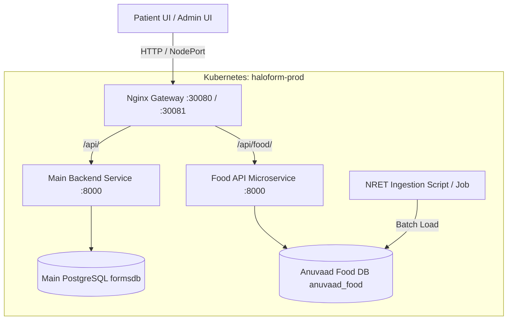

# Anuvaad Food Dataset & API Cluster Deployment Guide

This document provides a complete guide for deploying the **Anuvaad Food Dataset (NRET)** into an isolated database within the Kubernetes cluster, creating a dedicated **Food API Microservice**, configuring the **Nginx Gateway**, and integrating it into the **Halo Application (Patient UI / Admin UI)**.

---

## 1. System Architecture



---

## 2. Step-by-Step Implementation

### Step 1: Deploy Dedicated Food Database (`food-db`)

Create an isolated PostgreSQL StatefulSet with persistent storage dedicated exclusively to the food dataset.

**File:** `halo_k8s/08-food-db.yaml`
```yaml
apiVersion: v1
kind: Service
metadata:
  name: food-db
  namespace: haloform-prod
  labels:
    app: food-db
spec:
  ports:
    - port: 5432
      targetPort: 5432
  selector:
    app: food-db
  clusterIP: None

---
apiVersion: apps/v1
kind: StatefulSet
metadata:
  name: food-db
  namespace: haloform-prod
spec:
  serviceName: food-db
  replicas: 1
  selector:
    matchLabels:
      app: food-db
  template:
    metadata:
      labels:
        app: food-db
    spec:
      containers:
        - name: postgres
          image: postgres:16-alpine
          ports:
            - containerPort: 5432
          env:
            - name: POSTGRES_DB
              value: "anuvaad_food"
            - name: POSTGRES_USER
              value: "food_admin"
            - name: POSTGRES_PASSWORD
              valueFrom:
                secretKeyRef:
                  name: haloform-secrets
                  key: FOOD_DB_PASSWORD
          volumeMounts:
            - name: food-db-data
              mountPath: /var/lib/postgresql/data
  volumeClaimTemplates:
    - metadata:
        name: food-db-data
      spec:
        accessModes: [ "ReadWriteOnce" ]
        resources:
          requests:
            storage: 10Gi
```

Apply to cluster:
```bash
kubectl apply -f halo_k8s/08-food-db.yaml
```

---

### Step 2: Ingest Anuvaad / NRET Dataset

Create the table schema with PostgreSQL `pg_trgm` (trigram matching) enabled for high-performance fuzzy search and autocomplete.

#### Database Schema (`schema.sql`)
```sql
CREATE EXTENSION IF NOT EXISTS pg_trgm;

CREATE TABLE IF NOT EXISTS food_items (
    id SERIAL PRIMARY KEY,
    food_name TEXT NOT NULL,
    food_name_hindi TEXT,
    category TEXT,
    serving_size TEXT DEFAULT '100g',
    energy_kcal NUMERIC(8, 2),
    protein_g NUMERIC(8, 2),
    carbs_g NUMERIC(8, 2),
    fat_g NUMERIC(8, 2),
    fiber_g NUMERIC(8, 2),
    micronutrients JSONB,
    raw_data JSONB,
    created_at TIMESTAMP WITH TIME ZONE DEFAULT CURRENT_TIMESTAMP
);

-- Trigram index for fuzzy text search and autocomplete
CREATE INDEX IF NOT EXISTS idx_food_name_trgm ON food_items USING gin (food_name gin_trgm_ops);
CREATE INDEX IF NOT EXISTS idx_food_category ON food_items (category);
```

#### Python Data Ingestion Script (`seed_food_data.py`)
```python
import os
import json
import pandas as pd
import psycopg2
from psycopg2.extras import execute_values

DB_HOST = os.getenv("DB_HOST", "localhost")
DB_PORT = int(os.getenv("DB_PORT", "5432"))
DB_NAME = os.getenv("DB_NAME", "anuvaad_food")
DB_USER = os.getenv("DB_USER", "food_admin")
DB_PASS = os.getenv("DB_PASSWORD", "food_secure_password")

def seed_database(dataset_path: str):
    print(f"Reading dataset from {dataset_path}...")
    df = pd.read_csv(dataset_path) if dataset_path.endswith('.csv') else pd.read_json(dataset_path)

    conn = psycopg2.connect(
        host=DB_HOST, port=DB_PORT, dbname=DB_NAME, user=DB_USER, password=DB_PASS
    )
    cursor = conn.cursor()

    records = []
    for _, row in df.iterrows():
        records.append((
            str(row.get('food_name', '')).strip(),
            str(row.get('food_name_hindi', '')).strip() if pd.notna(row.get('food_name_hindi')) else None,
            str(row.get('category', 'General')),
            str(row.get('serving_size', '100g')),
            float(row.get('energy_kcal', 0)) if pd.notna(row.get('energy_kcal')) else 0.0,
            float(row.get('protein_g', 0)) if pd.notna(row.get('protein_g')) else 0.0,
            float(row.get('carbs_g', 0)) if pd.notna(row.get('carbs_g')) else 0.0,
            float(row.get('fat_g', 0)) if pd.notna(row.get('fat_g')) else 0.0,
            float(row.get('fiber_g', 0)) if pd.notna(row.get('fiber_g')) else 0.0,
            json.dumps(row.to_dict())
        ))

    insert_query = """
        INSERT INTO food_items (
            food_name, food_name_hindi, category, serving_size,
            energy_kcal, protein_g, carbs_g, fat_g, fiber_g, raw_data
        ) VALUES %s
    """
    
    print(f"Inserting {len(records)} records...")
    execute_values(cursor, insert_query, records, page_size=1000)
    conn.commit()
    cursor.close()
    conn.close()
    print("Anuvaad Food Dataset seeding complete!")

if __name__ == "__main__":
    seed_database("anuvaad_nret_food_dataset.csv")
```

---

### Step 3: Food API Microservice

Create a dedicated microservice in `food-api/` providing high-speed search and item lookup.

#### `food-api/main.py`
```python
import os
from fastapi import FastAPI, Query, HTTPException
from fastapi.middleware.cors import CORSMiddleware
import psycopg2
from psycopg2.extras import RealDictCursor
from contextlib import contextmanager

app = FastAPI(title="Anuvaad Food Service", version="1.0.0")

app.add_middleware(
    CORSMiddleware,
    allow_origins=["*"],
    allow_methods=["*"],
    allow_headers=["*"],
)

@contextmanager
def get_db():
    conn = psycopg2.connect(
        host=os.getenv("DB_HOST", "food-db"),
        database=os.getenv("DB_NAME", "anuvaad_food"),
        user=os.getenv("DB_USER", "food_admin"),
        password=os.getenv("DB_PASSWORD", "food_secure_password"),
        port=int(os.getenv("DB_PORT", 5432)),
        cursor_factory=RealDictCursor
    )
    try:
        yield conn
    finally:
        conn.close()

@app.get("/health")
def health_check():
    return {"status": "healthy", "service": "food-api"}

@app.get("/search")
def search_food(q: str = Query(..., min_length=2, description="Search query"), limit: int = 15):
    """
    Fuzzy search using PostgreSQL Trigram similarity and prefix matching.
    """
    with get_db() as conn:
        with conn.cursor() as cur:
            query = """
                SELECT id, food_name, food_name_hindi, category, serving_size,
                       energy_kcal, protein_g, carbs_g, fat_g, fiber_g,
                       similarity(food_name, %s) AS match_score
                FROM food_items
                WHERE food_name ILIKE %s OR food_name % %s
                ORDER BY match_score DESC, food_name ASC
                LIMIT %s;
            """
            cur.execute(query, (q, f"%{q}%", q, limit))
            items = cur.fetchall()
            return {"query": q, "count": len(items), "matches": items}

@app.get("/items/{item_id}")
def get_item(item_id: int):
    with get_db() as conn:
        with conn.cursor() as cur:
            cur.execute("SELECT * FROM food_items WHERE id = %s", (item_id,))
            item = cur.fetchone()
            if not item:
                raise HTTPException(status_code=404, detail="Food item not found")
            return item
```

#### `food-api/Dockerfile`
```dockerfile
FROM python:3.11-slim
WORKDIR /app
COPY requirements.txt .
RUN pip install --no-cache-dir -r requirements.txt
COPY . .
EXPOSE 8000
CMD ["uvicorn", "main:app", "--host", "0.0.0.0", "--port", "8000"]
```

---

### Step 4: Deploy `food-api` to Kubernetes

**File:** `halo_k8s/09-food-api.yaml`
```yaml
apiVersion: v1
kind: Service
metadata:
  name: food-api
  namespace: haloform-prod
spec:
  ports:
    - port: 8000
      targetPort: 8000
  selector:
    app: food-api

---
apiVersion: apps/v1
kind: Deployment
metadata:
  name: food-api
  namespace: haloform-prod
spec:
  replicas: 2
  selector:
    matchLabels:
      app: food-api
  template:
    metadata:
      labels:
        app: food-api
    spec:
      containers:
        - name: food-api
          image: halo-food-api:latest
          imagePullPolicy: IfNotPresent
          ports:
            - containerPort: 8000
          env:
            - name: DB_HOST
              value: "food-db"
            - name: DB_NAME
              value: "anuvaad_food"
            - name: DB_USER
              value: "food_admin"
            - name: DB_PASSWORD
              valueFrom:
                secretKeyRef:
                  name: haloform-secrets
                  key: FOOD_DB_PASSWORD
          resources:
            requests:
              cpu: 100m
              memory: 128Mi
            limits:
              cpu: 500m
              memory: 512Mi
```

---

### Step 5: Gateway Configuration

Update `halo_k8s/07-gateway.yaml` to route `/api/food/` to the new service.

```yaml
# In gateway-nginx-config Data Section:
events {}
http {
    # Patient Platform (Port 9090)
    server {
        listen 9090;

        location /api/food/ {
            proxy_pass http://food-api:8000/;
            proxy_set_header Host $host;
            proxy_set_header X-Real-IP $remote_addr;
            proxy_set_header X-Forwarded-For $proxy_add_x_forwarded_for;
        }

        location /api/ {
            proxy_pass http://backend:8000/api/;
            proxy_set_header Host $host;
            proxy_set_header X-Real-IP $remote_addr;
        }

        location / {
            proxy_pass http://patient-ui:80/;
            proxy_set_header Host $host;
        }
    }

    # Admin Platform (Port 9091)
    server {
        listen 9091;

        location /api/food/ {
            proxy_pass http://food-api:8000/;
            proxy_set_header Host $host;
            proxy_set_header X-Real-IP $remote_addr;
        }

        location /api/ {
            proxy_pass http://backend:8000/api/;
            proxy_set_header Host $host;
        }

        location / {
            proxy_pass http://admin-ui:80/;
            proxy_set_header Host $host;
        }
    }
}
```

Reload gateway:
```bash
kubectl apply -f halo_k8s/07-gateway.yaml
kubectl rollout restart deployment/gateway -n haloform-prod
```

---

### Step 6: Frontend Integration (Dietary Recall Component)

Update `patient-ui/src/services/svasthyamApi.js` (or replace with cluster endpoint):

```javascript
/**
 * Cluster Food API Service
 * Interacts with the Anuvaad food dataset via internal Gateway proxy /api/food/
 */

const API_BASE = '/api/food';

export const matchFoodItem = async (queryText) => {
  if (!queryText || queryText.trim().length < 2) return [];

  try {
    const res = await fetch(`${API_BASE}/search?q=${encodeURIComponent(queryText)}&limit=10`);
    if (!res.ok) {
      throw new Error(`Food API responded with status ${res.status}`);
    }
    const data = await res.json();
    return data.matches || [];
  } catch (error) {
    console.error('[Food API] Search error:', error);
    return [];
  }
};
```

---

## 3. Verification & Testing

1. **Verify Pods:**
   ```bash
   kubectl get pods -n haloform-prod
   ```
   Ensure `food-db-0` and `food-api-xxxx` are in `Running` state.

2. **Verify Food Search via Gateway:**
   ```bash
   curl -s "http://localhost:30080/api/food/search?q=rice" | jq .
   ```

3. **Verify UI Autocomplete:**
   - Open Patient UI at `http://localhost:30080`
   - Open a form with the **24-Hour Dietary Recall** field
   - Type food items (e.g., `roti`, `rice`, `dal`) and observe matching suggestions from the internal database.
