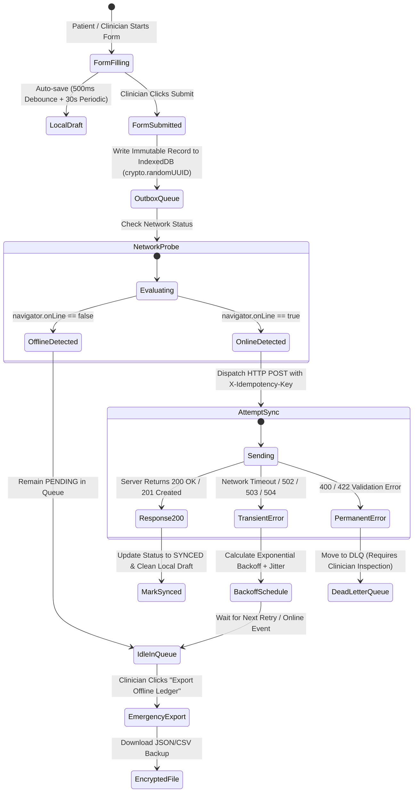
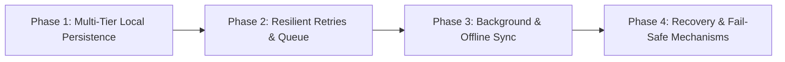

# Zero-Data-Loss Offline Resilience Implementation Plan

> **Status: SHIPPED & VERIFIED (2026-11-05)**
> All 4 phases, including Database-Native Idempotency, 500ms Debounced Auto-Save, Exponential Backoff with Jitter, Service Worker BackgroundSync, and Emergency Offline Ledger Export, are fully implemented and verified in both production builds.

---

## Architecture Comparison: Baseline vs. Shipped Architecture

| Feature                      | Baseline State (`patient-ui`)                       | Shipped Zero-Data-Loss Architecture                                                                 | Implementation Location                                                                                                                                                                                         |
| :--------------------------- | :---------------------------------------------------- | :-------------------------------------------------------------------------------------------------- | :-------------------------------------------------------------------------------------------------------------------------------------------------------------------------------------------------------------- |
| **Storage Engine**     | IndexedDB via `localforage`                         | IndexedDB + `navigator.storage.persist()` eviction immunity                                       | [`patient-ui/src/main.jsx`](file:///Users/apple/Desktop/form-creation/patient-ui/src/main.jsx#L22)                                                                                                             |
| **Draft Protection**   | Drafts stored in `saved_drafts` (30s interval only) | 500ms debounced auto-save on typing + 30s interval + `beforeunload` emergency listener            | [`patient-ui/src/App.jsx`](file:///Users/apple/Desktop/form-creation/patient-ui/src/App.jsx#L503)                                                                                                              |
| **Retry Strategy**     | Simple loop incrementing `retryCount`               | Exponential backoff with full randomized jitter + circuit breaker                                   | [`patient-ui/src/utils/syncQueue.js`](file:///Users/apple/Desktop/form-creation/patient-ui/src/utils/syncQueue.js#L9)                                                                                          |
| **Background Sync**    | Active only when tab is open (`setInterval`)        | Service Worker Background Sync API (syncs when tab is closed) + foreground `online` reactive sync | [`patient-ui/vite.config.js`](file:///Users/apple/Desktop/form-creation/patient-ui/vite.config.js#L35)                                                                                                         |
| **Server Idempotency** | No deduplication key passed                           | `X-Idempotency-Key` / `client_submission_id` enforced by database index                         | [`backend/main.py`](file:///Users/apple/Desktop/form-creation/backend/main.py#L223), [`backend/models.py`](file:///Users/apple/Desktop/form-creation/backend/models.py#L72)                                   |
| **Disaster Recovery**  | No manual data recovery option                        | One-click "Export Offline Ledger" (JSON) for manual ingestion + central admin bulk import           | [`SubmissionHistory.jsx`](file:///Users/apple/Desktop/form-creation/patient-ui/src/components/SubmissionHistory.jsx#L68), [`backend/main.py`](file:///Users/apple/Desktop/form-creation/backend/main.py#L165) |

---

## Architecture Flow & State Machine



---

## Phase Breakdown



---

### Phase 1: Multi-Tier Local Persistence (Client-Side)

#### Task 1.1: Browser Storage Eviction Immunity (`navigator.storage.persist`)

* **Objective:** Prevent Chromium/WebKit/Gecko from evicting IndexedDB under device low-disk pressure.
* **Target File:** `patient-ui/src/main.jsx`
* **Implementation:**
  1. Call `navigator.storage.persisted()` on app initialization.
  2. If `false`, execute `navigator.storage.persist()`.
  3. Integrate storage quota health check from `useStorageQuota.js` to log and display alerts if usage exceeds 80%.

#### Task 1.2: Form Draft Keystroke Auto-Save Engine

* **Objective:** Eliminate loss of partially entered questionnaires caused by accidental tab closure, app navigation, or battery cutoffs.
* **Target File:** `patient-ui/src/App.jsx` (Form Rendering / `FillForm` flow)
* **Implementation:**
  1. Add a 500ms debounced write to `saveDraft(draftId, formId, formTitle, currentAnswers)`.
  2. Add a `window.addEventListener('beforeunload')` handler when unsaved modifications exist to perform an emergency local write.
  3. Pre-populate existing active draft when loading any form by matching `formId` in `saved_drafts`.

#### Task 1.3: Immutable Outbox Record Schema

* **Objective:** Ensure submissions queued while offline preserve all necessary routing metadata, security context, and schema versions.
* **Target File:** `patient-ui/src/utils/storage.js`
* **Specification for Outbox Record:**
  ```typescript
  interface QueuedSubmission {
    id: string;               // crypto.randomUUID() (Used as Idempotency Key)
    formId: number;           // Safe numeric ID
    formTitle: string;        // Human-readable title
    formVersion: number;      // Form schema version when filled
    payload: Record<string, any>; // Form answers
    metadata: {
      projectId?: number | null;
      hospitalId?: number | null;
      centerId?: string | null;
      submittedBy: string;
      deviceTimestamp: string;
      appVersion: string;
    };
    targetUrl: string;        // Full endpoint with query params preserved
    syncStatus: 'PENDING' | 'SYNCING' | 'SYNCED' | 'FAILED' | 'DLQ_REVIEW';
    retryCount: number;
    nextRetryAt: number;      // Epoch ms timestamp for backoff
    lastAttemptAt: string | null;
    lastError: string | null;
  }
  ```

---

### Phase 2: Resilient Automatic Retries & Queue Lifecycle

#### Task 2.1: Exponential Backoff with Full Jitter

* **Objective:** Prevent repeated failed network attempts from draining device battery or causing a thundering herd on recovering backend servers.
* **Target File:** `patient-ui/src/utils/syncQueue.js`
* **Specification:**
  - Base delay: $t_{\text{base}} = 2\,\text{seconds}$
  - Multiplier: $2^{\text{retryCount}}$
  - Maximum delay cap: $t_{\text{max}} = 300\,\text{seconds}$ (5 minutes)
  - Jitter range: $0.5 \times \text{delay} \le t_{\text{actual}} \le 1.5 \times \text{delay}$
  - Only process queue items where `Date.now() >= item.nextRetryAt`.

#### Task 2.2: Circuit Breaker & Batch Concurrency

* **Objective:** Throttle concurrent sync requests and pause the sync loop when encountering continuous connection timeouts.
* **Target File:** `patient-ui/src/utils/syncQueue.js`
* **Specification:**
  - Sequential processing (`concurrency: 1`) to preserve submission chronology.
  - If 3 consecutive submissions fail due to network timeouts (`Failed to fetch` / `NetworkError`), trip the circuit breaker and pause processing for 30 seconds.

#### Task 2.3: Dead-Letter Queue (DLQ) for Unrecoverable Errors

* **Objective:** Separate transient connection failures (5xx, offline) from permanent data/schema validation errors (400, 422).
* **Target File:** `patient-ui/src/utils/storage.js` and `patient-ui/src/utils/syncQueue.js`
* **Specification:**
  - If server responds with HTTP 400 or 422 (malformed JSON or validation rule breach), mark `syncStatus = 'DLQ_REVIEW'`.
  - Unblock subsequent queued forms from syncing.
  - Display a badge in the UI navigation: *"1 item requires clinician review"*.

---

### Phase 3: True Background & Offline Syncing

#### Task 3.1: Service Worker Background Synchronization

* **Objective:** Allow the browser to flush the offline queue even after the user closes the browser tab or locks the device.
* **Target Files:**
  - `patient-ui/vite.config.js` (`VitePWA` configuration)
  - `patient-ui/src/sw.js` (Custom Service Worker)
* **Specification:**
  1. Register sync tag: `registration.sync.register('clinical-intake-sync')`.
  2. In `sw.js`, bind `self.addEventListener('sync', (event) => ...)` to execute `syncPendingSubmissions()` in the worker thread.
  3. Include a fallback: if `SyncManager` is unsupported (Safari on iOS), fall back to foreground `online` event handling and periodic interval loops.

#### Task 3.2: Reactive Foreground Synchronization

* **Objective:** Instantly start queue flush the moment `window.navigator.onLine` transitions to `true`.
* **Target File:** `patient-ui/src/utils/useNetworkStatus.js`
* **Specification:**
  - Listen to `window.addEventListener('online', ...)`.
  - Perform an immediate lightweight health ping (`GET /api/patient/forms`) to confirm actual internet throughput (captive portal detection) before dispatching the queue.

#### Task 3.3: Manual Inspection & Force-Sync UI Controls

* **Objective:** Give field supervisors full transparency and control over local queue state.
* **Target File:** `patient-ui/src/components/SubmissionHistory.jsx`
* **Specification:**
  - Display exact sync status pills: `Synced`, `Queued (Retrying in Xs)`, `Failed (DLQ)`.
  - Add **"Force Sync Now"** button to bypass backoff timers and attempt immediate network dispatch.
  - Add **"Edit & Retry"** button for DLQ items with validation errors.

---

### Phase 4: Recovery, Conflict & Fail-Safe Mechanisms

#### Task 4.1: Server-Side Idempotency Keys (Prevent Double Ingestion)

* **Objective:** Eliminate duplicate records when a client sends a submission, the server commits it, but the cellular network drops before the HTTP 200 response reaches the client.
* **Target Files:**
  - `backend/models.py`
  - `backend/schemas.py`
  - `backend/main.py`
* **Specification:**
  1. Add column to `Submission` model: `client_submission_id = Column(String(36), unique=True, index=True, nullable=True)`.
  2. In `POST /api/patient/forms/{form_id}/submissions`, extract `X-Idempotency-Key` or `client_submission_id` from body.
  3. Check if a submission with this ID already exists:
     - If exists: Return existing record with HTTP `200 OK` without creating a duplicate.
     - If not: Insert new record and commit transaction.

#### Task 4.2: Emergency Offline Disaster Recovery Export

* **Objective:** Ensure data can be extracted manually even if the device cannot reconnect to the network for weeks or suffers hardware/network chip failure.
* **Target File:** `patient-ui/src/utils/storage.js` and `patient-ui/src/components/SubmissionHistory.jsx`
* **Specification:**
  - **"Export Offline Ledger"** button generates a downloadable `.json` file containing all `PENDING`, `FAILED`, and `DLQ_REVIEW` items.
  - Includes cryptographic hash (SHA-256) of each submission to guarantee data integrity during transport.

#### Task 4.3: Central Admin Bulk Import Endpoint

* **Objective:** Allow central administrators to ingest offline ledger files collected from field USB drives.
* **Target File:** `backend/main.py`
* **Specification:**
  - Endpoint: `POST /api/admin/submissions/bulk-import`
  - Accepts exported JSON ledger, validates each entry against its form version schema, verifies idempotency keys, and ingests all records in a single database transaction.

#### Task 4.4: Schema Version Locking

* **Objective:** Prevent submissions created offline from failing if an administrator publishes a new version of the form while the field device is disconnected.
* **Target File:** `backend/main.py`
* **Specification:**
  - Store and validate against the specific `form_version_id` associated with the form definition cached on the client at the time of data collection.

---

## Implementation Roadmap & Execution Status

| Phase                                           | Core Deliverables                                                                                   | Target Files                                                                                                                                                                                                                                                 |      Status      |
| :---------------------------------------------- | :-------------------------------------------------------------------------------------------------- | :----------------------------------------------------------------------------------------------------------------------------------------------------------------------------------------------------------------------------------------------------------- | :---------------: |
| **Phase 1: Multi-Tier Local Persistence** | Quota persistence request, 500ms draft auto-save, `beforeunload` listener, expanded outbox schema | [`storage.js`](file:///Users/apple/Desktop/form-creation/patient-ui/src/utils/storage.js), [`main.jsx`](file:///Users/apple/Desktop/form-creation/patient-ui/src/main.jsx), [`App.jsx`](file:///Users/apple/Desktop/form-creation/patient-ui/src/App.jsx) | **Shipped** |
| **Phase 2: Resilient Retries & Queue**    | Full jitter exponential backoff, circuit breaker, DLQ separation                                    | [`syncQueue.js`](file:///Users/apple/Desktop/form-creation/patient-ui/src/utils/syncQueue.js), [`storage.js`](file:///Users/apple/Desktop/form-creation/patient-ui/src/utils/storage.js)                                                                   | **Shipped** |
| **Phase 3: Background Syncing**           | Workbox Service Worker Background Sync API, reactive online sync, force sync UI                     | [`vite.config.js`](file:///Users/apple/Desktop/form-creation/patient-ui/vite.config.js), [`SubmissionHistory.jsx`](file:///Users/apple/Desktop/form-creation/patient-ui/src/components/SubmissionHistory.jsx)                                              | **Shipped** |
| **Phase 4: Recovery & Fail-Safe**         | Server-side `X-Idempotency-Key`, database unique index, offline ledger JSON export, bulk import   | [`models.py`](file:///Users/apple/Desktop/form-creation/backend/models.py), [`main.py`](file:///Users/apple/Desktop/form-creation/backend/main.py), [`migrate.py`](file:///Users/apple/Desktop/form-creation/backend/migrate.py)                          | **Shipped** |

---

## Verification & Testing Gates

1. **Simulated Link Drop (Chrome DevTools Network: Offline):**
   - Fill out 3 separate forms.
   - Confirm records appear in `submission_queue` in IndexedDB.
   - Refresh page; confirm data is retained and pending badges update in navigation.
2. **Sudden Power/Tab Kill Test:**
   - Type half of a form, immediately close the tab without submitting.
   - Reopen app; verify draft auto-recovery prompt loads all field values.
3. **Flaky Connection & Idempotency Test:**
   - Simulate 500ms latency with 50% packet drop.
   - Trigger sync; verify backend rejects duplicates via `client_submission_id` and client transitions status to `SYNCED`.
4. **Disaster Recovery File Test:**
   - Cut network completely, export offline ledger `.json`.
   - Ingest JSON file via Admin Bulk Import endpoint; confirm all records match 1:1.
